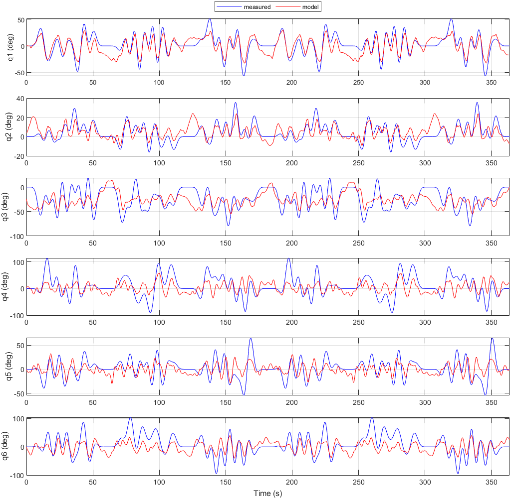

# KUKA robot identification benchmark: checking a published paper (System Identification course, final project)

**Author:** MohammadMahdi Faraji
**Course:** System Identification, Dr. Mahdi Aliyari Shoorehdeli, fall 2025 (1404). This was my final project for the course.

For the final project I chose the paper *Dataset and Baseline for an Industrial Robot Identification Benchmark* by Weigand, Götz, Ulmen and Ruskowski (TU Kaiserslautern). The authors moved a big KUKA KR300 R2500 ultra SE industrial robot (6 joints, 1120 kg, 300 kg payload, 2.5 m reach) along 36 planned paths. They recorded the motor torques and the joint positions and published the data together with two simple linear models as a baseline. Anyone can then try their own model on the same data and compare it with the baseline.

In the course I reproduced the linear baseline and then tried nonlinear models (NLARX and Hammerstein-Wiener). I was not sure about my nonlinear results, so first I wanted to be sure about the base: do I really get the numbers of the paper, and is what the paper says about the data true? In this repository I start from the raw recordings of the robot, build the benchmark files again, train the baseline models again and check 53 statements of the paper one by one. The nonlinear part will be added after I check it again.

The short answer: all result tables of the paper come out the same, to the last printed digit. Most statements are right, but 9 are not right as printed, and the data has a few properties that the paper does not mention. For example, the "2 Hz low pass filter" also makes every signal 4.5 % smaller.

<p align="center"></p>
<p align="center"><sub>The forward baseline of the paper (version 2), trained again here. Blue: measured joint positions of the test run. Red: output of the linear model, which only sees the six motor torques.</sub></p>

## The idea in simple words

A robot arm can be described in two directions:
- **Forward model:** "if I send these torques to the motors, where will the joints go?" Input: 6 torques. Output: 6 joint angles.
- **Inverse model:** "to move the joints like this, which torques do I need?" Input: 6 angles, 6 velocities and 6 accelerations. Output: 6 torques.

The paper gives one linear model for each direction and grades it with two numbers:
- **NRMSE:** the typical error of the model divided by the typical size of the changes of the signal (its standard deviation). 0 is a perfect model, 1 is as good as always guessing the average value. The forward baseline gets 0.83 on the test data, so it is only a bit better than guessing the average. The inverse baseline gets 0.61.
- **R²:** how much of the variation of the signal the model explains, in percent. With the correct formula R² = 100 (1 - NRMSE²), so it carries the same information.

Checking a paper is a bit like baking a cake from a cookbook. If my cake looks and tastes like the photo, the recipe works. If it doesn't, either the recipe has a mistake or I made one, and I have to find out which. Here I also looked at the ingredients themselves (the raw data), to see if they are what the cookbook says.

## At a glance

| | |
|---|---|
| Paper | Weigand et al., version 2.0 (April 2023) and version 1 (January 2022), links below |
| Data | 12 recordings at 250 Hz, 73 minutes in total: 11 for training (67 min), 1 for testing (6 min). The benchmark files keep every 25th sample (10 Hz): 39988 training and 3636 test samples |
| Forward baseline | linear state-space model with 12 states (`n4sid`), test NRMSE 0.825 (mean of the 6 joints) |
| Inverse baseline | one 6 x 18 matrix, test NRMSE 0.609 |
| What I checked | 53 statements of the paper and 5 extra observations, each with a status |
| Main result | the result tables are reproduced exactly; 38 statements confirmed, 9 not right as printed, 3 true but not mentioned, 3 can't be decided |
| Tools | MATLAB R2024b with System Identification, Control System, Optimization and Signal Processing toolboxes |
| Run time | about 4.5 minutes (one model is loaded from a file, training it again takes 2.5 hours) |

## Results

### 1. The result tables of the paper come out the same

| Table of the paper | model | test NRMSE in the paper | test NRMSE here | all 28 numbers the same |
|---|---|---:|---:|:---:|
| Table 4, version 2 | forward, `n4sid` | 0.82517 | 0.82517 | yes |
| Table 5, version 2 | inverse, matrix fitted with `fminunc` | 0.6085 | 0.6085 | yes |
| Table 4, version 1 | forward, `ssest` model saved by the authors | 1.1173 | 1.1173 | yes |
| Table 5, version 1 | inverse, matrix saved by the authors | 1.0503 | 1.0503 | yes |
| Table 4, version 1 | forward, `ssest` trained again from scratch (2.5 h) | 1.1173 | 1.1173 | yes |
| Table 5, version 1 | inverse, `fmincon` run again | 1.0503 | 1.0508 | no, see below |

Each table has 28 numbers (NRMSE and R² for training and test data, for 6 joints and their mean). All of them are side by side in [`results/tables/paper_tables_reproduced.md`](results/tables/paper_tables_reproduced.md). The only table that is not exactly the same is the last one. The official code of version 1 starts the optimizer from random numbers without a fixed seed and stops it after 10000 evaluations, so nobody can get exactly the same matrix again. With seed 1 the NRMSE values differ from the paper by at most 0.001.

### 2. What I found that the paper does not say

1. **The R² values of version 1 were wrong.** The official code of version 1 measures the total variation around the mean of the model output instead of the mean of the measured signal. The version 1 tables come out the same only with this formula. With the correct formula, the mean test R² of version 1 is -40.4 % for both models, not +22.3 % and +18.3 %. A negative R² means the model is worse than guessing the average. Version 2 of the paper says it "corrected the calculation of the coefficient of determination", and this is the correction. (My course project had copied the same formula, see below.)
2. **The 2 Hz low pass filter also shrinks the signals by 4.5 %.** The filter is a Chebyshev type I filter of order 4 with 0.2 dB ripple. For an even order the gain at 0 Hz sits at the bottom of the ripple (-0.2 dB), and `filtfilt` uses the filter twice, so slow signals are multiplied by 0.955. In the data, the benchmark positions are 0.956 times the raw positions. The positions of the inverse dataset go through the filter once more, so they are again 0.956 times the forward positions.
3. **The velocities and accelerations of the inverse dataset are late.** The paper says these inputs are shifted by 4 ms. In the data they are computed from the position with the filter s/(1 + 0.5 s) (once for the velocity, twice for the acceleration). Compared with the measured velocity they come about 0.5 s late for the velocity and 0.9 s late for the acceleration, and they are about 10 % and 18 % smaller.
4. **The better inverse result of version 2 comes from a constant term.** From version 1 to version 2 the test NRMSE of the inverse model went from 1.05 to 0.61. Version 1 fits torque = A [q; q̇; q̈] without a constant term. Normalizing the data in version 2 adds a constant term without saying so. Plain least squares with a constant term gives exactly the test values of Table 5 of version 2. The constant is mostly the gravity torque on joints 2 and 3.
5. **The robot runs in closed loop.** The measured joint positions follow the planned (reference) positions within 0.035 to 0.26 deg RMS. If I take 0.955 times the reference as a "model", the test NRMSE is below 0.03, while the forward baseline gets 0.83. This is not a fair model, because the reference is not an input of the benchmark. But it shows why "torque in, position out" is hard here: the controller decides where the joints go, and the torque is just what it needs to get there.
6. **Figures 2 and 4 of the paper don't show the benchmark data.** They show each torque minus its first value (the input that the version 1 code gives to the model). For example τ2 of the training data is between -15.3 and 7.2 Nm in the data file, but between about -2 and 20 Nm in the figure.

Smaller points in the text:
- Listing 2 does not run as printed. `lsim` refuses the time vector of the data file, because its steps are not exactly 0.1 s (0.1000275 s in the test data, because the official script uses `linspace(0, N*dt, N)`).
- Eq. (1) has no constant term, no 2π and no sample time. The real reference paths need all three.
- The text says the frequency grid goes up to 1 Hz, but the reference paths have no frequency content above 0.2 Hz.
- Section 2.2 says the velocity loop runs at 2500 Hz. Table 8 gives a cycle time of 0.2 ms, which is 5000 Hz.
- Eq. (4) writes gravity and the hydraulic counterbalance as functions of the velocity, g(q̇_R) and τ_H(q̇_R). Both depend on the position, so it should be g(q_R) and τ_H(q_R).
- The caption of Fig. 6 names colors (black, brown) that the figure doesn't use.
- Table 3 says the motor torque is the sum of the feed-forward and the feedback torque. In the data this sum does not explain the measured torque.

Every finding with its numbers is explained in [`docs/findings.md`](docs/findings.md), and all 58 checks are in [`results/all_checks.csv`](results/all_checks.csv).

### 3. All checks

| status | meaning | count |
|---|---|---:|
| MATCH | reproduced exactly, at the precision printed in the paper | 23 |
| CONSISTENT | the data support the statement | 15 |
| DEVIATION | the data contradict the statement, or the paper contradicts itself | 9 |
| UNDOCUMENTED | true about the data or the official code, but not mentioned in the paper | 3 |
| UNCLEAR | can't be decided with the published material | 3 |
| OBSERVATION | not a statement of the paper, but useful for anyone who uses the data | 5 |

## How it works, step by step

`run_all.m` runs 8 steps, in the order of the paper. Everything a step prints is also saved in `results/logs/`.

1. **From the raw data to the benchmark files** (`steps/step1_dataset_from_raw.m`). Runs the official post-processing script on a temporary copy of the raw data and compares its output with the published files (largest difference 3e-12). Then it does the same processing again, written from the text of the paper (filter, then keep every 25th sample), and gets exactly the same files.
2. **The planned paths** (`step2_experiment_design.m`). Fits the sum of sines and cosines of eq. (1) to all 72 runs (largest error 7e-6 deg with 10 harmonics of 1/60 Hz). Checks that every path starts and ends at rest in the home pose, that each of the 36 paths was driven twice, that the 3 test paths are not in the training data, and the joint limits of Table 7.
3. **Sensors, controller and the inputs of the inverse dataset** (`step3_sensors_controller_inverse.m`). Velocity channels, gearbox deformation, sensor noise, time shifts and the torque channels.
4. **Forward baseline, version 2** (`step4_forward_baseline_v2.m`). Listing 2: normalize the data, `n4sid` with 12 states, simulate the test data from a zero state. Table 4 and Fig. 7.
5. **Inverse baseline, version 2** (`step5_inverse_baseline_v2.m`). Listing 3: normalize the data, fit the 6 x 18 matrix with `fminunc` (seed 1234). Table 5 and Fig. 8.
6. **Version 1** (`step6_v1_baselines.m`). The models that the authors saved with version 1, the R² formula of version 1, the changes of version 2, Fig. 9.
7. **Version 1 trained again** (`step7_v1_retrained.m`). The `ssest` model trained again from scratch (`step7a_retrain_v1_ssest.m`, only with `run_all('full')`) and `fmincon` from three random start points.
8. **Section 5, Figs. 2 to 6 and the text** (`step8_section5_figures_text.m`). The statements about the signals, the figures, and a few points that I checked by reading the PDF.

Every check is one call of `functions/add_check.m` with an id, the section of the paper, the statement, the value in the paper, what I found, and a status. For most checks the status comes from a simple rule in the code, for example "MATCH if every number is the same". For the others I chose the status after looking at the numbers, and F1, F2 and X1 to X4 compare with things I read from the PDF.

## My course version and its mistakes

The scripts I handed in are in [`legacy/original_course_submission/`](legacy/original_course_submission/), unchanged except for the path to the data. Compared with this repository:
- The course version reproduced only the forward baseline of version 2 (Table 4). The inverse model, version 1 and the statements about the data were not checked.
- Its R² used the wrong formula of the version 1 code, so the R² values on page 11 of my report were wrong (mean 32.35 % instead of 31.14 %). The NRMSE values and the final comparison table of the report were right.
- The file names between the steps don't match, and one script is missing.

More details are in [`docs/changes_from_course_project.md`](docs/changes_from_course_project.md).

## Limitations

- Tested only with MATLAB R2024b on Windows. Another MATLAB version may give slightly different `n4sid` or `ssest` models, so the last digit of a table could change.
- The normal run loads the version 1 `ssest` model that I trained again once (2.5 hours) from `results/models/`. `run_all('full')` trains it again.
- Some checks compare with values that I read by eye from the PDF (F1, F2, X4). The evidence text of these checks says so.
- The PDF files of the paper are not in this repository, because I could not find their license. The links are below.
- I checked the statements that can be tested with the data. Other parts of the paper, for example the nonlinear robot model of Appendix A, are not checked.

## How to run

1. Download the official data (about 222 MB) and put it in `data/`, as described in [`data/README.md`](data/README.md).
2. In MATLAB, go to the folder of this repository and run:
   ```
   run_all
   ```
   After about 4.5 minutes the results are in `results/`: `all_checks.csv`, `summary.txt`, `tables/`, `figures/` and `logs/`.
3. To train the version 1 `ssest` model again as well (about 2.5 hours more):
   ```
   run_all('full')
   ```

You need MATLAB (tested with R2024b) with the System Identification Toolbox, the Control System Toolbox, the Optimization Toolbox and the Signal Processing Toolbox.

## Files

```
├── run_all.m                             runs all steps and writes the results
├── steps/                                the 8 steps (and 7a), one file each
├── functions/                            small helpers: NRMSE, R², table comparison, plots, loading the data
├── data/README.md                        how to get the official data (not in this repository)
├── results/                              all_checks.csv, summary.txt, tables/, figures/, logs/, models/
├── docs/                                 every finding with its numbers, what changed since the course
└── legacy/original_course_submission/    my original course scripts (February 2026)
```

## Paper and data

- **Paper, version 2.0** (April 9, 2023): J. Weigand, J. Götz, J. Ulmen, M. Ruskowski, *Dataset and Baseline for an Industrial Robot Identification Benchmark*, Technische Universität Kaiserslautern. URN: [urn:nbn:de:hbz:386-kluedo-72843](https://nbn-resolving.org/urn:nbn:de:hbz:386-kluedo-72843)
- **Paper, version 1** (January 26, 2022): URN: [urn:nbn:de:hbz:386-kluedo-67317](https://nbn-resolving.org/urn:nbn:de:hbz:386-kluedo-67317)
- The paper has no DOI. The URN is its permanent identifier in KLUEDO, the publication server of the university.
- **Data:** DOI [10.26204/DATA/5](https://doi.org/10.26204/data/5), archive `Robot_Identification_Benchmark_With_Raw_Data`. License as given on the data page: MIT License, Creative Commons Attribution Share Alike 4.0 International.

## Thanks

- Dr. Mahdi Aliyari Shoorehdeli, for the course and the final project.
- The authors of the paper, for publishing the raw data and their code. Without the raw data most of these checks would not be possible.
- I used an AI assistant to help review and rewrite the code, to clean it up and prepare it for publishing.

## License

My code is under the MIT license, see [LICENSE](LICENSE). The data is not part of this repository and has its own license (see above).
